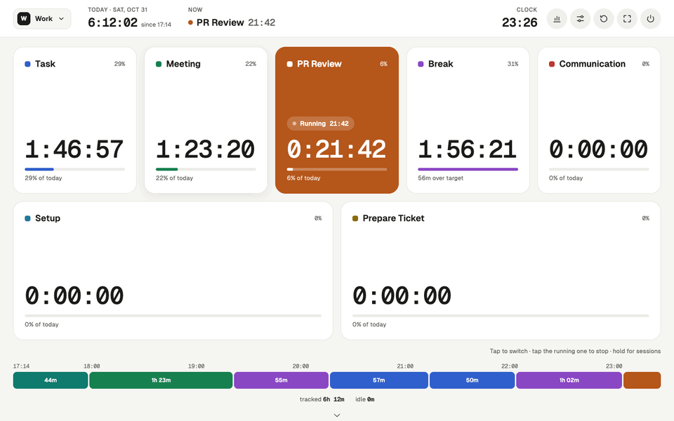
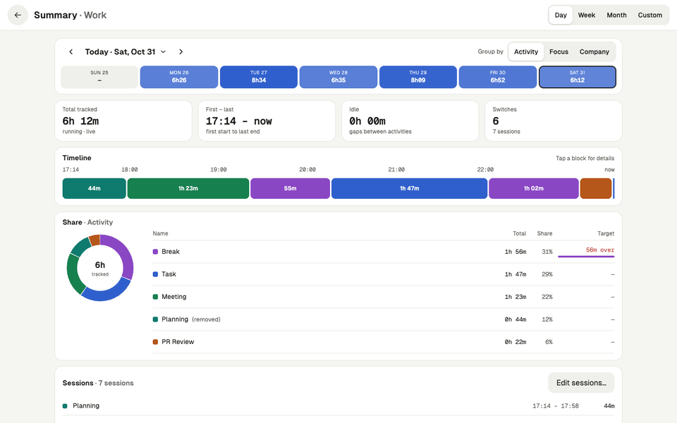
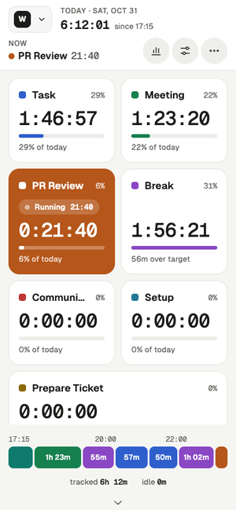

# Activity Tracker

A touchscreen "chess clock" for the work day. Tap an activity to start it; tapping another one switches to it, and
tapping the active one stops everything. It tracks today's total, a total per activity and the current run, and you can
backdate a switch ("I actually started this at 14:30"). The Summary shows any day, week, month or range, split by
activity or by your own categories.



More screens, desktop and phone: **[docs/screenshots](docs/screenshots/README.md)**.

| Summary | Phone |
| --- | --- |
|  |  |

Docs: [docs/SPEC.md](docs/SPEC.md) (the full spec), [docs/DESIGN.md](docs/DESIGN.md) (layout rules for changes
without a new design), [docs/SIMILAR-TOOLS.md](docs/SIMILAR-TOOLS.md) (comparable apps).

## Setup
Preact + TypeScript, built with Vite. Install the dependencies once:
```sh
npm install
```

## Run
```sh
scripts/start.sh             # app window (resizable, closable) — the main way to run it
scripts/start.sh --kiosk     # locked full screen, no window controls
scripts/start.sh --browser   # normal browser window with tabs
```
`start.sh` is a bash script: run it directly (or with `bash`), not with `node`. It rebuilds `dist/` when the sources
changed, then serves it on `http://localhost:8765`. The npm shortcuts do the same:
`npm start`, `npm run start:browser`, `npm run start:kiosk`.

Closing the window (or the in-app ⏻ button) also stops the script and its local server.
To start it at login, copy `pomodoro-tracker.desktop` to `~/.config/autostart/` and fix the path in `Exec=`.

### Develop
```sh
npm run dev         # Vite dev server with hot reload (a different origin: its data is separate)
npm run build       # type-check + build to dist/
npm test            # Vitest
npm run typecheck
```

### Optional: plain HTML file
```sh
npm run build:single   # -> dist-single/activity-tracker.html, open it by double-click
```
This file does not keep the screen on, and its data is **separate** from `scripts/start.sh` (a different browser
origin). Use export/import to move data between them. Rebuild it after code changes.

### Optional: any static web server
Run `npm run build` and copy `dist/` to any static host (a subpath works too). Each browser on each device keeps its
own data; nothing syncs, so use export/import to move data. Prefer HTTPS: on plain HTTP the screen isn't kept awake
and storage may be evicted.

## Use
- **Tap** to switch the activity; **tap the active row** to stop all.
- **Long-press** a row to see its sessions and to set "active since…" or "stop all since…"; "Edit sessions…" opens
  the day editor, where ‹ › step to earlier days so any day can be corrected.
- Header: the profile button (with more than one profile), today's total, what is running, the clock, and round
  icons for summary, settings, reset day (archives the day), full screen and close. Below the buttons: the strip of
  unused activities, today's timeline and the group totals; scroll down for the footer (links, quick theme switch).
- **Profiles** (Settings → Profiles): separate workspaces, e.g. "Work" and "Home", each with its own activities,
  days, summary, settings (appearance too) and backup file. Only one is open at a time; switch with the profile
  button in the header. A new profile starts with a copy of the open profile's settings.
- **Groups** (Settings → Groups): sort activities into groups inside one profile and switch groups on or off; the
  main screen shows only activities of groups that are on (and ungrouped ones). Several groups can be on at once,
  and a switch stays until you change it.
- **Summary** (header chart icon): a Day, Week, Month or Custom period with ‹ › and a calendar picker; figure tiles,
  the day's timeline or one row per day, the share per activity, and the day's sessions. It ticks live while an
  activity runs.
- **Categories** (Settings → Categories): dimensions such as Focus (Productive / Non-productive) or Company (With
  people / Alone). Each activity picks at most one option per dimension; the Summary can group time by any dimension,
  with the rest shown as "Not set".
- **Settings → Appearance → Theme:** 7 built-in themes (Paper, Graphite, Dune, Tokyo Night, Gruvbox Dark, Nord,
  Solarized Light), fixed or following the system's light/dark mode. **Import theme** reads our own theme files,
  VS Code color themes, base16 (`.yaml`/`.json`), Alacritty `.toml` and iTerm `.itermcolors`. Each activity has one of
  16 color slots (**Activity colors**), so it changes color with the theme. Built-in themes live in
  [`config/themes/`](config/themes/).
- **Settings → Appearance → Main screen:** buttons as Tiles/Rows/Circles, size by today's usage, unused activities
  in a strip, and show or hide the timeline, group totals and footer.
- Activity names are unique. A removed activity can be restored or deleted from the list; its history stays, and
  adding the same name again continues it.
- Switches shorter than a minute are not counted (the time goes to the next or previous activity); change the
  threshold in **Settings → Day → Minimum switch**. The same section sets the reset hour and the first day of the week.
- The screen stays on while the app is open; turn this off in **Settings → Device → Keep the screen on**.
- **Esc** goes back (popup → screen → main). In full screen, hold Esc to leave full screen.

## Data
- First-run profiles, groups, activities and default settings come from [`config/seed.json`](config/seed.json).
  Edit it before the first start (or on a fresh profile/origin); later changes are made in Settings.
- Imported themes are shared by all profiles; an export embeds the imported themes its profile uses.
- Stored in IndexedDB in the Chromium profile `~/.local/share/activity-tracker/chromium`, for the origin
  `http://localhost:8765`. Always use the same port and profile, or you will see an empty database.
- Back up with **Settings → Export JSON**, one file per profile. **Import JSON** replaces only the open profile. You can also turn on auto-export on day close.

## Tests
```sh
npm test
```
